# Orbit Store for PS4 (Beta)

### A modern, no-BS download manager for PS4.

Orbit runs on your PS4. Pick a game, choose its source and format, and Orbit downloads it straight to the console or a USB drive plugged into it, then installs it for you. Use it on your TV with a controller from the Games row, or pair a phone or computer to manage the same downloads over your home network.

Explore **1,110 PS4 games** with **1,227 download options**, plus **533 DLCs and add-ons with 535 options across 120 games**. Choose your source and save to your preferred drive. New games, add-ons and corrected links arrive through catalogue updates.

  <a href="assets/0.0.1/native-crossbar-discover.jpg">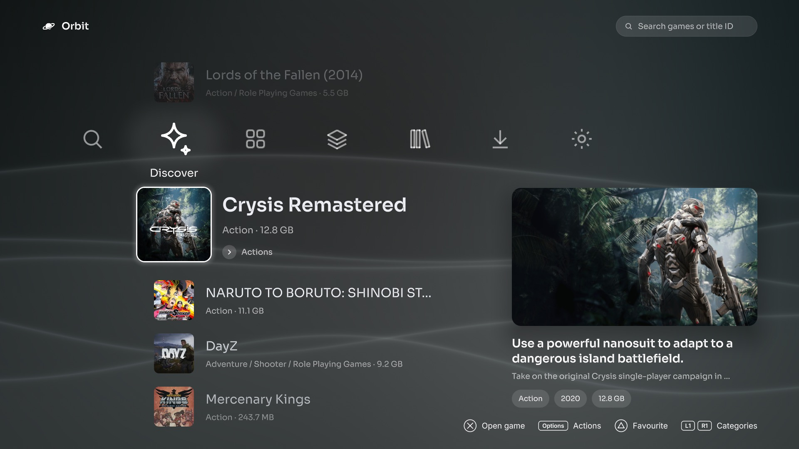</a>
  <a href="assets/0.0.1/native-store-game-details.jpg">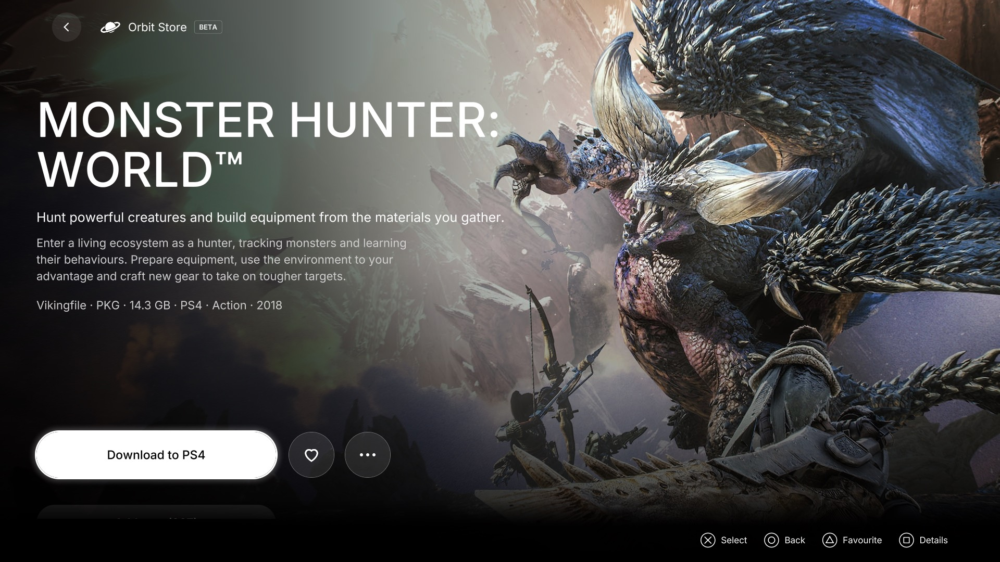</a>

 

[Get started](guides/getting-started.md) · [Download Orbit](https://github.com/saawant12/orbit-store-ps4/releases/latest) · [Guides](guides) · [Report an issue](https://github.com/saawant12/orbit-store-ps4/issues/new?template=bug_report.md) · [Request a feature](https://github.com/saawant12/orbit-store-ps4/issues/new?template=feature_request.md) · [Appearance guide](guides/appearance.md) · [Troubleshooting](guides/troubleshooting.md)

> **Also from Orbit:** [Orbit Store for PS5](https://github.com/saawant12/orbit-store-ps5), with Orbit Zero for Mac, Windows and Linux, and [Orbit Play](https://github.com/saawant12/orbit-play-ps5), to stream your jailbroken PS5 to your computer.

## Features

**Find games**

- **Discover and Browse** with source, format, genre, region and size filters, matching game counts and eight [game tags](guides/downloads.md#game-tags). Select several sources, formats or genres at once.
- **Hide games you already have** installed on the PS4.
- **Favourites.** Save games you want to return to and find them again quickly.
- **Saved filters.** Name your filters once and apply them again in the TV app or the browser. [Guide](guides/saved-filters.md)
- **DLC and add-ons** from the Add-ons page or a game’s details. [DLC guide](guides/add-ons.md)
- **Firmware requirements.** See the required firmware for each download option when that information is available.

**Download**

- **One link per download.** PKG and FPKG, with ZIP, RAR and 7z archives unpacked automatically.
- **Choose 1–64 connections per download**, with eight as the default. Active downloads share a limit of 64; TorBox uses at most eight per game. [Guide](guides/downloads.md#follow-your-queue)
- **Filter for TorBox.** With your account connected, choose **Source → TorBox available** to find supported options.
- **Optional accounts** for [TorBox](guides/downloads.md#torbox), [Archive.org](guides/downloads.md#archiveorg-sign-in) and [Vikingfile](guides/vikingfile.md).
- **Notifications** on your PS4, phone or computer. [Setup](guides/notifications.md)
- **Optional automatic shutdown** after downloads and installations finish, with a countdown you can cancel. [Guide](guides/shutdown.md)

**Install and manage**

- **Install without leaving Orbit.** PKG and FPKG games and DLC install through the PS4’s own package installer. [Guide](guides/install-games.md)
- **Library** of the games installed on your PS4, kept up to date automatically. [Library guide](guides/library.md)
- **File manager** for your PS4’s drives: copy, move, rename, delete, unpack and install. [Files guide](guides/files.md)
- **Save files from your PS4.** Use **Library → Files** to save a file to your paired phone or computer. [Guide](guides/files.md#save-a-file-to-another-device)

**Use it your way**

- **Native TV app** built for your controller. Downloads keep running when you close it.
- **Nothing to start first.** The TV app brings its own ELF loader and starts Orbit through GoldHEN by itself. GoldHEN AutoRun can start Orbit when the PS4 turns on.
- **Four interfaces:** Store, Crossbar, Cinema and Panorama, with 26 interface languages. [Appearance guide](guides/appearance.md)
- **Control from your phone.** Pair once to browse, queue and follow downloads.
- **No Orbit account. No telemetry.**

## Get started

**Two ways to use Orbit**

| Do this | Orbit appears in | What it is |
|---|---|---|
| Install `orbit_store_ps4.pkg` with GoldHEN’s Package Installer | **Games** on your PS4 | The TV app, used with your controller. It includes the download service. |
| Send `orbit_store.elf` to an ELF loader on port 9021 | **Orbit Store Browser** on your PS4 | Opens Orbit in the PS4’s Internet Browser. Keep Orbit’s download service running on the PS4 to use it. |

Both versions share the same downloads, favourites and service settings, so seeing two Orbit icons on your PS4 is normal. Appearance is saved separately in each.

You need a PS4 with GoldHEN, internet access on the console and enough writable storage. Turn on GoldHEN’s payload loader once, in **GoldHEN → Servers Settings → Enable PayLoader Server**, so Orbit can start.

1. **Install Orbit.** Download the files from the [latest release](https://github.com/saawant12/orbit-store-ps4/releases/latest), verify them and follow the table above. Use the TV app, the browser version or both. Close other apps, such as ezRemote, before opening Orbit.
2. **Choose your sources.** Choose sources in the TV app’s setup screen or **App settings → Sources & accounts**. Select the sources you want to use, including Archive.org, Vikingfile and AkiraBox, and acknowledge the download notice. Your choices apply to both versions.
3. **Pick a download.** Open a game and select its main download button to review **Download options**. Choose **Source**, **Download using** and **Save to**, then confirm. Vikingfile first checks for a direct link using your sign-in. If AkiraBox or Vikingfile needs verification, its page opens on the PS4; complete it and select **Download**. Orbit catches the link and returns to the app.
4. **Install it.** When the download finishes, choose **Install on PS4**.
5. **Follow your queue.** Open Downloads on the TV or a paired device to check progress, pause or resume.

See the [setup and update guide](guides/getting-started.md) for installation, auto-start, updates and phone pairing.

## See how it works

Open Orbit from your Games row and use the controller to browse, explore and choose a download. The TV app shares your catalogue, favourites and download queue with the browser version. These screenshots are from the TV app on a PS4.

### Discover, browse and choose a download

**Start with something new.** Discover opens first. **New on Orbit** brings featured picks and recent additions to the first row, followed by **Latest releases**. Move down to All games to explore a grid that loads more games as you scroll.

**Store (default)**

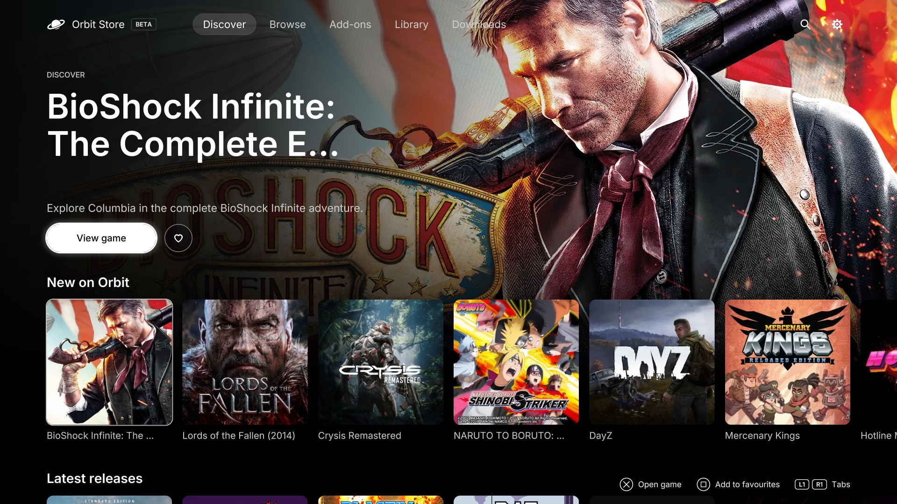

**Keep exploring.** All games gives each title its own tile. Move through the grid with your controller; more games appear as you keep scrolling.

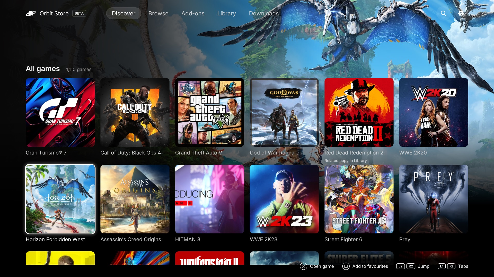

**Find your next game.** Search by name or title ID, narrow the collection by genre, tag, source, format, region or size, and browse the newest known releases first.

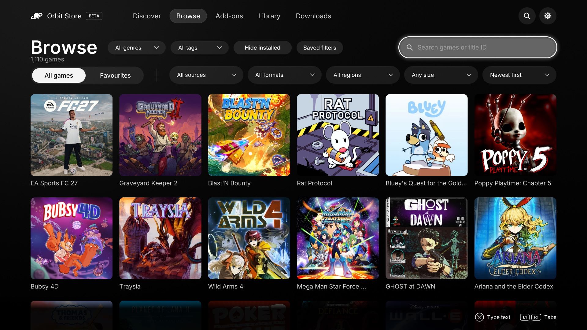

**Get to know a game.** Read its description, save it to favourites, or open the three-dot menu for its publisher, release date, title ID and download size. The main download button opens your options before anything starts.

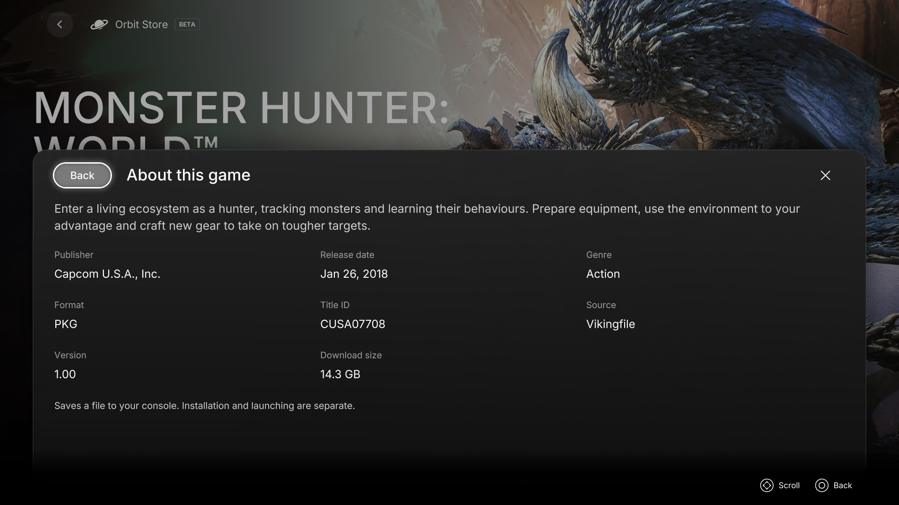

**Choose how and where to download.** Review the source, delivery method and drive together. Vikingfile uses your saved sign-in when available and opens its provider page on the PS4 if verification is needed. See the [download guide](guides/downloads.md), including [TorBox](guides/downloads.md#torbox).

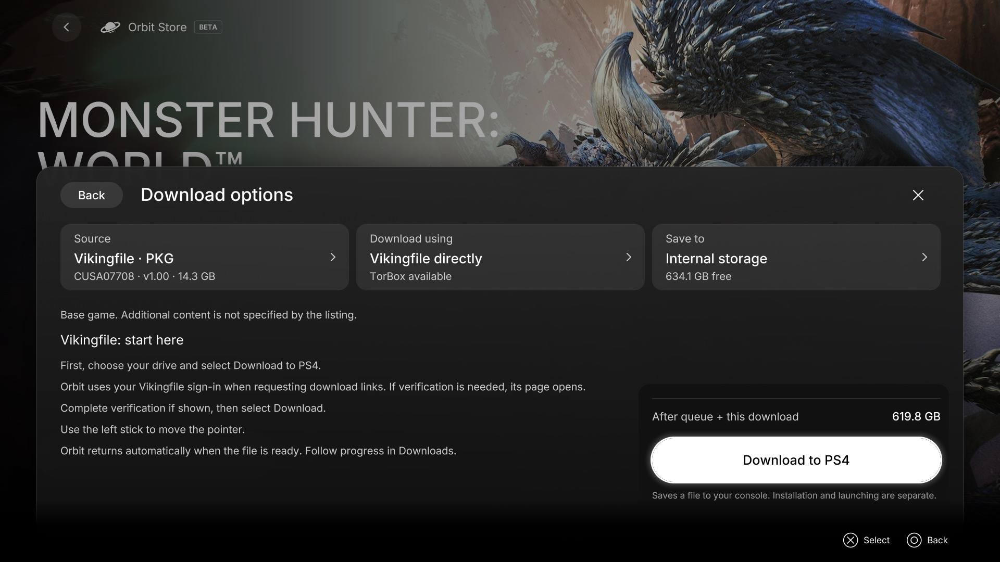

### Choose your interface

Make Orbit look the way you like. Open **Appearance** and choose **Store**, **Crossbar**, **Cinema** or **Panorama**. Confirm your choice to keep it. The interfaces are available in the TV app and the browser version; switching keeps your downloads, favourites and settings. See the [appearance guide](guides/appearance.md) for the 15-second confirmation, controller shortcuts, motion options and where to find settings in each layout.

**Crossbar**

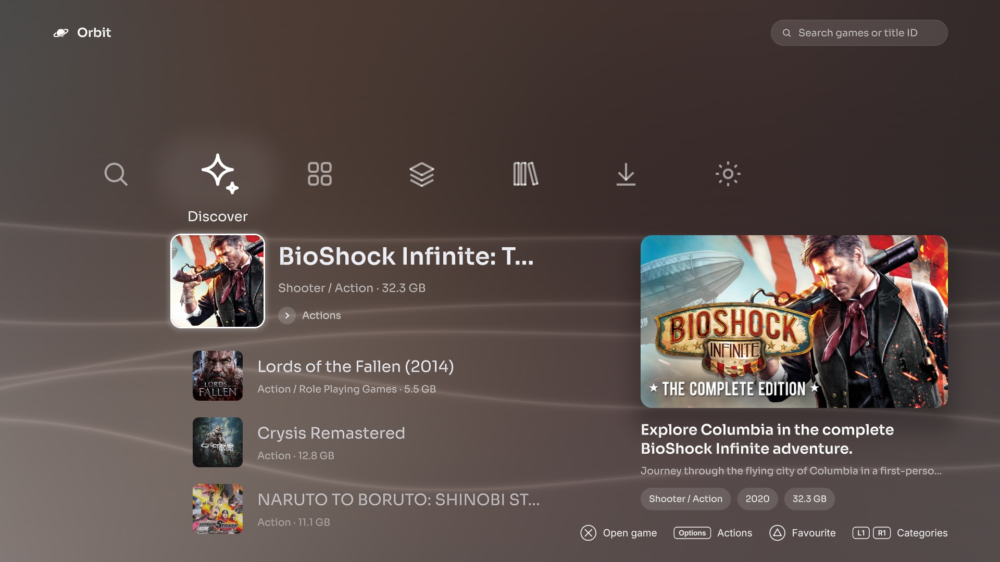

 

**Cinema**

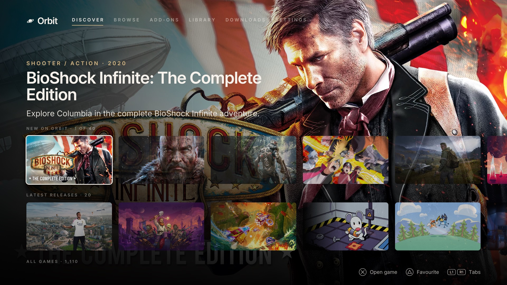

 

**Panorama**

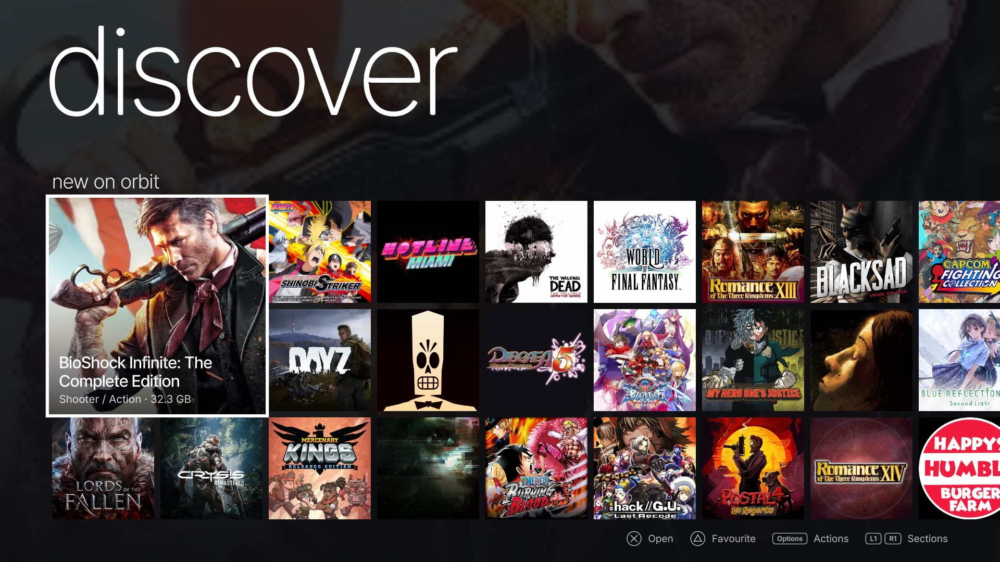

### Choose how Orbit works

The instructions below use Store’s settings names. In Crossbar, Cinema and Panorama, the main menu is called **Settings**; see [Find settings after switching](guides/appearance.md#find-settings-after-switching).

Choose sources, set your default drive, pair a phone and refresh your game catalogue from one place. **Update Orbit** updates the TV app and download service together; you choose when to install or restart.

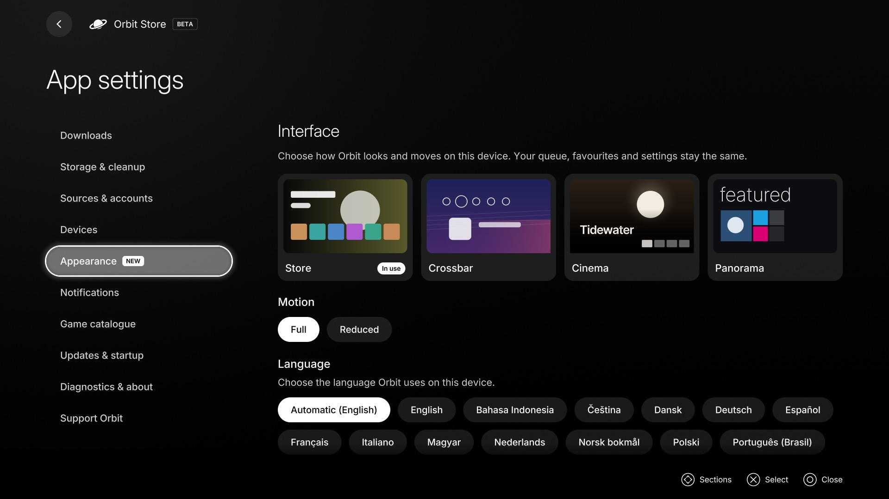

### Orbit in your language

Orbit supports **English, Arabic, Czech, Danish, Dutch, Finnish, French, German, Greek, Hungarian, Indonesian, Italian, Japanese, Korean, Norwegian Bokmål, Polish, Portuguese (Brazil), Portuguese (Portugal), Romanian, Russian, Spanish, Swedish, Turkish, Ukrainian, Simplified Chinese and Traditional Chinese**. In the TV app, choose a language in **App settings → Appearance**, or keep **Automatic** to follow your PS4’s system language. In the browser version, use **App settings → Appearance → Language** in Store, or **Settings → Appearance → Language** in the other interfaces, to choose a language for that device, or leave it on **Automatic** to follow the browser.

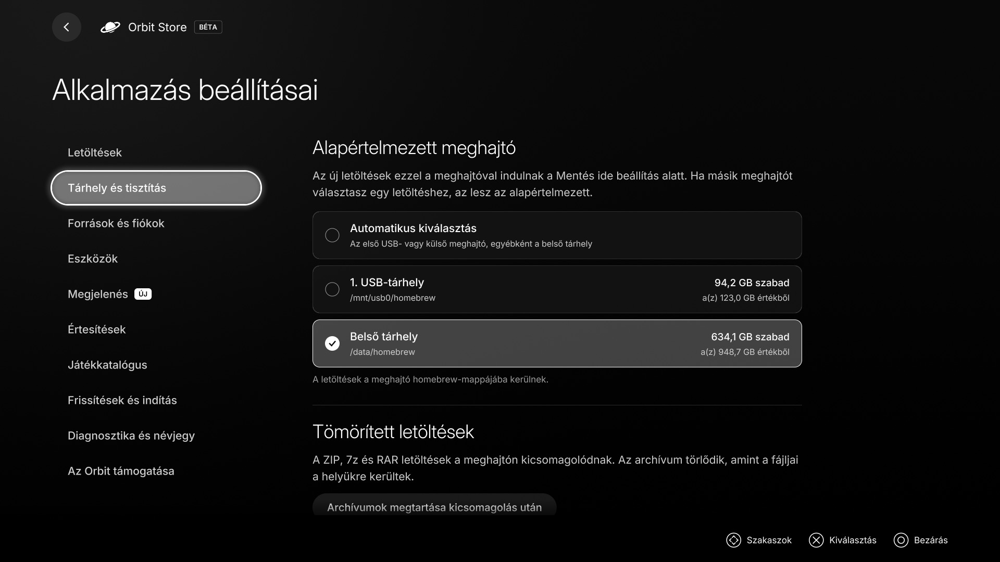

Language settings change Orbit’s menus; each game keeps its own language settings. See [language settings](guides/getting-started.md#choose-your-language) for instructions.

## Beta status

**Orbit Store for PS4 is an experimental beta.** [Download the latest release](https://github.com/saawant12/orbit-store-ps4/releases/latest). Release **0.0.1** has these version numbers:

| Component | Version |
| --- | --- |
| Orbit Store download service and browser interface (`orbit_store.elf`) | **0.0.1** |
| Native TV app (`orbit_store_ps4.pkg`) | **0.0.1** |

The TV app’s title ID is `ORBT00002` and the browser icon’s is `ORBT00001`. These are homebrew project IDs, not official Sony ones.

Tested on a PS4 on firmware 12.00 with GoldHEN. Compatibility can vary with other firmware and GoldHEN versions. If something goes wrong, use the [bug report format](.github/ISSUE_TEMPLATE/bug_report.md) and include your versions and the error shown.

**Payload-manager setup is opt-in.** Choose **App settings → Updates & startup → Payload managers → Add Orbit** to let Orbit add and update a copy in LaunchPad or Homebrew Launcher. GoldHEN AutoRun is a separate choice.

## Using the beta

The [release downloads](https://github.com/saawant12/orbit-store-ps4/releases/latest) include:

- [orbit_store_ps4.pkg](https://github.com/saawant12/orbit-store-ps4/releases/latest/download/orbit_store_ps4.pkg), the native TV app with the download service and elfldr, and [its checksum](https://github.com/saawant12/orbit-store-ps4/releases/latest/download/orbit_store_ps4.pkg.sha256).
- [orbit_store.elf](https://github.com/saawant12/orbit-store-ps4/releases/latest/download/orbit_store.elf), the download service and browser interface, and [its checksum](https://github.com/saawant12/orbit-store-ps4/releases/latest/download/orbit_store.elf.sha256).
- The complete source and licence bundle for the service, browser interface, TV app and their open-source components, with build instructions.

Follow the [verification commands](guides/getting-started.md#verify-the-ps4-files), then the installation steps for your version.

The ELF is too big for GoldHEN’s own payload loader and LaunchPad; send it to an ELF loader on port 9021, such as elfldr. Orbit then saves its service and elfldr, and adds the **Orbit Store Browser** icon. Only download material you have permission to obtain and use.

After a reboot, run GoldHEN as usual. Open the TV app to start Orbit, or let GoldHEN AutoRun or LaunchPad start it. The Orbit Store Browser icon needs Orbit already running. Right after the PS4 turns on, the first start can take up to about 40 seconds longer.

Keep the PS4 awake while downloading. Closing the TV app or the browser leaves downloads running. After an unexpected interruption, downloads come back paused for review. **Restart Orbit** resumes downloads that were running before that restart.

## Updating or reinstalling Orbit

**Update Orbit in one step.** Choose **Update Orbit** under **App settings → Updates & startup** (**Settings → Updates & startup** in other layouts). It updates the TV app and download service together. Select **Close and reopen** when asked, then open Orbit from the Games row; the updated app starts its new service and resumes downloads interrupted by the restart. **Restart Orbit** restarts only the service. See the [update guide](guides/getting-started.md#update-orbit).

To restore a deleted Orbit Store Browser icon, start Orbit again. Your paired devices, source choices and download queue stay saved.

Loading an ELF while Orbit is already running saves it for the next start; it doesn’t replace the running service. The update panel shows **Running**, **Saved for next start** and **Latest release** separately. Updates are never installed just by opening the panel.

## Managing your downloads

Choose **1–64 connections per download** in **App settings → Downloads**; eight is the default. Active downloads share a total of 64 connections. Orbit retries with fewer when a host refuses several. Speed depends on the host, network and drive.

Open **Downloads** and choose **Active**, **Finished**, **Failed** or **Cancelled**. Move waiting downloads up or down to choose what runs next. A retry countdown tells you when Orbit will try an interrupted download again.

**Remove from history**, **Clear finished history** and **Clear cancelled history** let you keep the downloaded files or delete them. Check the paths and sizes before confirming. Removing downloaded files doesn’t uninstall a game. See [history and file removal](guides/downloads.md#remove-download-history-and-files).

Before queuing a game, check **Free now**, **Unfinished downloads** and **After queue + this download**. Files are saved in the selected drive’s `homebrew` folder; see [where downloads are saved](guides/downloads.md#where-downloads-are-saved).

## Your Library

Open **Library** to see the games installed on your PS4. Search by name, title ID or path and filter by status, location or format. Orbit reads the games from the console itself and keeps the list up to date automatically. Library works independently of your download-source choices.

Open **Library → Files** to browse drives and manage files: copy, move, rename, delete, unpack and install. See the [Files guide](guides/files.md). Orbit doesn’t start or uninstall games.

## Finding and saving games

In **Browse**, combine source, format, genre, tag, region and download-size filters, then choose a sort order. **Release date (newest first)** is the default; games without a recorded date follow alphabetically. **Reset filters** restores this order.

Open a game’s details and choose **Add to favourites**, or use the favourite shortcut on a selected game in the TV app: **Square** in Store, **Triangle** in Crossbar, Cinema or Panorama. Favourites are shared between the console and paired devices.

## Refreshing the game catalogue

New games appear automatically, without reinstalling or restarting Orbit. To check yourself, open **App settings → Game catalogue → Refresh catalogue**. Orbit also checks when it starts and every six hours. If your connection drops, you can still browse the last catalogue you had.

## Controls and formats

In the TV app, use the D-pad or left stick to move, Cross to select, Circle to go back, and follow the on-screen hints. In Store, **L1/R1** switches tabs. See the [controller guide](guides/appearance.md#controller-navigation-in-the-tv-app). In the browser, use the arrow keys, Enter and Escape, or touch and mouse.

| Format | What you get | What to do after it’s saved |
|---|---|---|
| **PKG**, **FPKG** | `.pkg` package | Choose **Install on PS4** on the finished download. |
| **ZIP**, **RAR**, **7z** | Archive | Orbit unpacks it after downloading. The label shows what’s inside when known, for example `RAR · PKG`. |

Source choices are saved on the console and shared by paired devices. Turning off a source hides its download options and pauses unfinished downloads without deleting files.

### Provider download steps

- **Vikingfile:** Orbit first asks for the file with your [Vikingfile account session](guides/vikingfile.md), when signed in, and starts the download straight away if it gets a ready link. If verification is needed, the page opens: complete it, move the pointer to **Download** with the left stick and press ○.
- **AkiraBox:** open the download page from Orbit, complete any verification, then select **Download**. AkiraBox may show an ad instead; close it and try again, or choose another source.

**Vikingfile and AkiraBox take a few minutes for now.** On PS4, the Cloudflare check on their pages can take 2–3 minutes to pass. Leave the page open: once the check passes, the download works as usual. We’re working on making this faster. With a Vikingfile Premium account [signed in to Orbit](guides/vikingfile.md), there’s usually no wait: Orbit gets the download without opening the page.

On a paired phone, these pages still open on the PS4. See the [full provider steps](guides/downloads.md#provider-steps).

### Automatic archive extraction

Orbit unpacks single-file **ZIP, RAR and 7z** downloads on the selected PS4 drive. Keep enough free space for the archive and its unpacked files. **Delete archives after extracting** is on by default under **App settings → Storage & cleanup**; it removes the archive only after a successful unpack.

For password-protected archives, Orbit tries these passwords by itself, so you usually don’t need to enter one:

- `DLPSGAME.COM`
- `[DLPSGAME.COM]`
- `SuperPSX`
- `www.DLPSGAME.COM`
- `downloadgameps3.com`
- `hako`
- `pippo`

Passwords are case-sensitive. If none works, select **Enter archive password**, enter the password from the source, then **Retry extraction**. Orbit keeps the archive so you don’t need to download it again.

## When something needs attention

When reporting a bug, follow the [bug report format](.github/ISSUE_TEMPLATE/bug_report.md) and [open a bug report](https://github.com/saawant12/orbit-store-ps4/issues/new?template=bug_report.md). Include your setup, the exact error and a diagnostic report when you can.

- **The TV app says Orbit didn’t start:** turn on GoldHEN’s payload loader, close other apps such as ezRemote and choose **Try again**.
- **Drive disconnected:** reconnect the same drive. Orbit never switches to internal storage by itself.
- **Not enough space:** free space on the selected drive before retrying.
- **Archive.org asks for an account:** [sign in to Archive.org](guides/downloads.md#archiveorg-sign-in), then retry. Signing in can’t bring back a file its provider removed.
- **Source changed:** keep the partial file until you decide to remove it and start again. Orbit won’t add a different file onto it.
- **Provider throttling:** let the retry wait finish. Orbit follows the provider’s requested wait.
- **Orbit Store Browser icon doesn’t open Orbit:** start Orbit from the TV app, LaunchPad or your ELF loader, then open the icon again.
- **Can’t connect:** check that Orbit is running and your device is on the same local network. Orbit uses TCP port **34177**.
- **Missed the pairing code:** select **Pair devices**. The PS4 keeps the code on screen; phones and computers can ask for the notification again every 30 seconds.

See [Troubleshooting](guides/troubleshooting.md) for more.

## Licence

Orbit Store is free software under the GNU General Public License, version 3 or later. Every release includes the complete source for its payload and TV app, the sources of their copyleft components, third-party licence notices and rebuild instructions.

Forks are welcome, as long as they share their source under the same licence.

> **Official channels:** Orbit Store has no official social media accounts. This GitHub repository is our official source for releases, updates and support. Any social media account claiming to officially represent Orbit Store is an impersonator.

> **Free, with optional support.** Orbit Store, Orbit Zero, Orbit Play and our upcoming apps are free and will stay free.
>
> If you’d like to support development, you can [contribute via crypto](https://github.com/saawant12/orbit-store-ps5/issues/131#user-content-support-with-crypto). Contributions help cover the costs of AI tools, test consoles, hardware and servers. It’s entirely optional. You can also find **Support Orbit** in the apps’ settings, with links and QR codes.
>
> The [crypto addresses in our support issue](https://github.com/saawant12/orbit-store-ps5/issues/131#user-content-support-with-crypto) are our only official support option for now.

---

## IMPORTANT: THIRD-PARTY CONTENT & DOWNLOAD DISCLAIMER

**Orbit Store is an independent download-management application. This project does not host, upload, mirror, or bundle the game files referenced by its catalogue.** File transfers happen directly between third-party providers and the user's selected device. This repository hosts Orbit's documentation and, when released, Orbit's own application files.

Catalogue entries reference publicly accessible third-party URLs. **Publicly accessible does not mean authorised, licensed, or free to redistribute.** Use Orbit only for material you have permission to obtain and use, in accordance with applicable law, relevant licences, and the provider's terms. Owning a game does not, by itself, establish permission to obtain any copy found online.

**Third-party files are outside this project's control.** Their hosts and uploaders control availability and contents. Orbit does not guarantee ownership, authenticity, completeness, safety, compatibility, or continued availability. Download completion, a matching file size, or a matching checksum is a technical result, not a licence or a guarantee that the file is safe to run.

All game names, artwork, trademarks, and other third-party materials belong to their respective owners. Orbit is **not affiliated with or endorsed by** Sony Interactive Entertainment, PlayStation, game publishers, or download providers. The app does not supply accounts, credentials, purchase entitlements, or permission to bypass access restrictions.

To report an incorrect entry or a rights concern, open an issue with the affected title, URL, and sufficient information to identify the concern. Do not post private personal information. The underlying hosting provider is responsible for files it hosts; Orbit's maintainers can review catalogue references controlled by this project.
