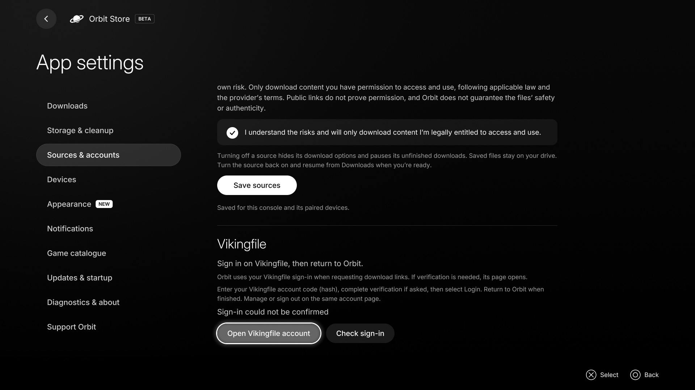

# Use a Vikingfile account

**For Orbit Store 0.0.1 for PS4.**

Vikingfile identifies an account with an **account hash**: the private code it gives you instead of an email and password. Treat it like a password and don’t include it in issues, screenshots or diagnostic reports.

## Sign in

In the TV app, open **App settings → Sources & accounts** and scroll to **Vikingfile**. In the browser, open **App settings → Sources & accounts → Vikingfile** (or **Settings → Sources & accounts → Vikingfile** in Crossbar, Cinema and Panorama). Choose **Open Vikingfile account**. On Vikingfile’s official page, enter your account code, complete verification if asked and select **Login**. Return to Orbit and choose **Check sign-in**.

*Vikingfile settings in the PS4 TV app, before the sign-in is confirmed. No account code is shown.*

Orbit shows **Signed in** only after Vikingfile confirms the session. Opening the page alone doesn’t count. To manage the account or sign out, reopen the same account page. The browser version and the TV app keep separate browser sessions, so you may need to sign in once in each one you use.

Orbit uses the active PS4 user’s Vikingfile session when it asks for, checks, downloads and resumes a file. These cookies aren’t stored in download history, shown in diagnostics or sent to TorBox or unrelated sites.

## Downloading after sign-in

For a Vikingfile game, choose a drive and select **Download to PS4**. Orbit first asks Vikingfile for the file using your session. If Vikingfile returns a ready link, the download starts without opening the provider page.

If Vikingfile asks for verification, its page opens full screen. Complete the verification, move the pointer to **Download** with the left stick and press ○. ✕ does nothing on this page, so a stray press can’t close it and lose the verification. Orbit catches the ready link and returns to the app. To give up, press the PS button, return to Orbit and cancel the download page there.

Premium features are controlled by Vikingfile. **Signed in** doesn’t mean the account is Premium or that every file skips verification. Expired sessions and provider checks fall back to the provider page; sign in again if needed. Free accounts still work.

[Downloads](downloads.md) · [Settings](settings.md) · [Troubleshooting](troubleshooting.md)
